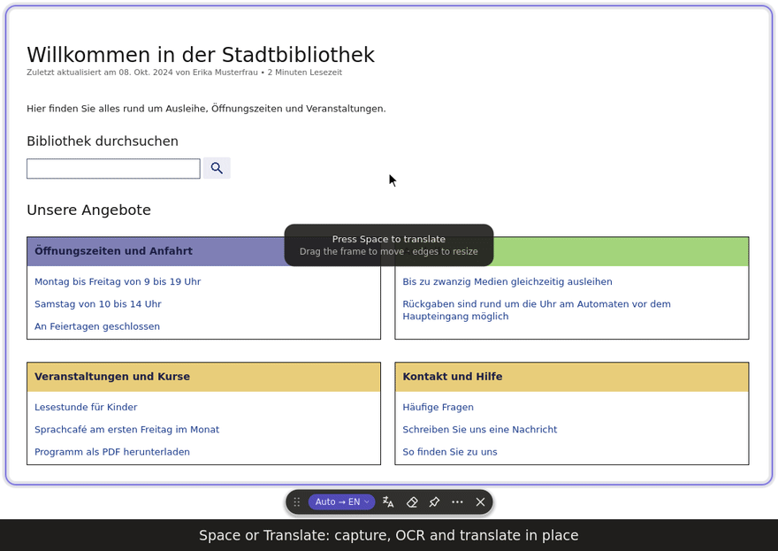
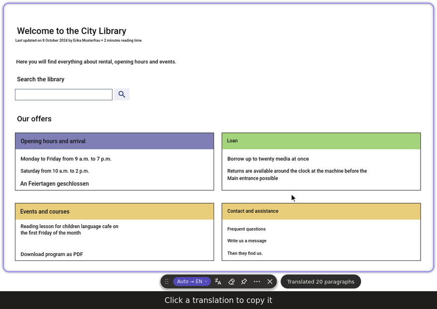
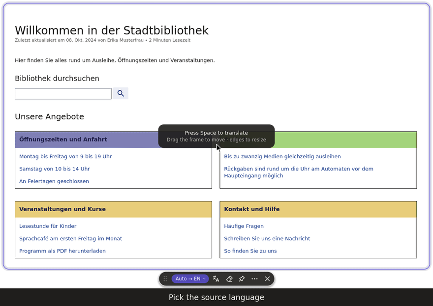

# py-translation

A small desktop tool that translates text anywhere on your screen, fully offline. Drag a transparent window over foreign text (German by default), press Space, and the text under it is captured, recognised with Tesseract, translated to English with a local neural model and drawn back over the original, Google Lens style. Nothing leaves your machine unless you opt in with `--online`.




## Requirements

- Linux with an **X11** session. On Wayland, screen capture returns black images and the app cannot work (see Troubleshooting).
- [uv](https://docs.astral.sh/uv/) (it downloads Python 3.13 itself). No `apt` packages and no `sudo` are needed.
- About 650 MB of disk for the Python environment and roughly 160 MB for the models.

## Quickstart

```
git clone https://github.com/sagwl96/py-translation.git && cd py-translation
uv sync
./scripts/setup_models.sh
./run.sh
```

`./scripts/setup_models.sh` downloads the German to English translation model (about 150 MB) and the Tesseract German data (about 1.5 MB) into `${XDG_DATA_HOME:-~/.local/share}/py-translation/`. It is safe to run again (it skips what is already there) and reuses an existing `~/.local/share/argos-translate` install or system-wide Tesseract data if it finds them. `--eng` also fetches the English OCR data.

## The window

The window is a see-through frame with a rounded purple outline. Only the area **inside** the frame is captured; the frame and the toolbar below it never are. Place the frame over the text, press Space, and the translations appear in place.

- **Move:** drag the frame outline, or the grip (dotted handle) at the left of the toolbar.
- **Resize:** drag the thin zone just outside the outline (edges and corners; the cursor changes). The minimum capture area is about 290 x 160.
- **Toolbar** (the dark pill under the frame): grip, language chip (click for "Detect automatically" / "German"; changing it clears cached translations), Translate (shows a spinner while working), Clear, Pin (always on top; tinted when on), More (keyboard shortcuts card, Quit) and Close. Tooltips show the shortcuts.
- While idle the middle of the frame shows a hint. While working, the translate button spins and the frame outline pulses. A short white glow on the frame confirms a capture. Messages appear as small toasts at the bottom of the frame.





## Keys

| Key | Action |
|---|---|
| Space | Capture the area inside the frame, OCR and translate |
| Esc | Clear the translated overlay |
| Click a translation | Copy its text to the clipboard (accent ring, "Copied" toast) |
| T | Toggle always-on-top (shows a toast) |
| Hold Alt | Peek at the original (hides the overlay while held) |

## Command-line flags

```
./run.sh [options]      # or: uv run pytranslate [options]
```

| Flag | Default | Meaning |
|---|---|---|
| `--src LANG` | `auto` | Source language code, or `auto` to detect German/English per paragraph |
| `--tgt LANG` | `en` | Target language code |
| `--offline` / `--online` | `--offline` | Offline uses only the local model. `--online` uses Google Translate instead (see below) |
| `--on-top` | off | Start with the window always on top (toggle with `T`) |
| `--ocr-lang LANGS` | `deu` (`eng` with `--src en`) | Tesseract language(s), e.g. `eng+deu` |
| `--beam N` | `2` | Translation beam size (higher is slower; 2 is about twice as fast as 4 with the same output on typical text) |
| `--min-conf N` | `40` | Drop OCR words with confidence below N (0-100) |
| `--save-captures DIR` | off | Save every capture as `DIR/<timestamp>.png` plus a `.json` (OCR lines, paragraphs, translations, settings, dpr). Attach these when reporting a capture that translates badly |

`./run.sh --help` lists them without opening a window. Only the German to English model is installed by the setup script; other language pairs need their own Argos package placed in the models directory.

## Optional: online translation (`--online`)

The default mode never touches the network at run time. If you prefer Google's translations, install the optional extra and pass the flag:

```
uv sync --extra online
./run.sh --online
```

**Privacy:** with `--online` the recognised text of every capture is sent to Google Translate. Without the extra installed, `--online` stops at startup with an error that says how to install it. There is no silent fallback: if the offline model is missing or fails, the original text is kept and the error is shown in the window.

## Troubleshooting

- **Black or empty screenshots / nothing is translated:** you are probably on Wayland. Log in with an X11 session instead (most display managers offer "Xorg" or "X11" on the login screen gear menu).
- **"Translation model not installed":** run `./scripts/setup_models.sh`.
- **"Tesseract language data 'deu' is missing":** run `./scripts/setup_models.sh`, or point `TESSDATA_PREFIX` at a directory with `deu.traineddata`.
- **A capture translates badly:** start with `./run.sh --save-captures ~/captures`, reproduce it, and look at the PNG and JSON written for that capture (they show what OCR read and how the text was grouped).

## Development

```
uv sync
QT_QPA_PLATFORM=offscreen uv run pytest -q
uv run pyflakes pytranslate tests scripts
QT_QPA_PLATFORM=offscreen uv run python scripts/bench.py    # timing of the capture pipeline
QT_QPA_PLATFORM=offscreen uv run python scripts/render_ui_states.py OUT_DIR   # PNGs of every UI state (light/dark, 1x/2x)
QT_QPA_PLATFORM=offscreen uv run python scripts/render_gifs.py   # the README GIFs in docs/ (real OCR + model, needs ffmpeg)
```

Tests and the benchmark need the models installed (`./scripts/setup_models.sh`) and no network.

| Module | Role |
|---|---|
| `pytranslate/config.py` | `Config` dataclass and the shared `CONFIG` instance (set from CLI flags) |
| `pytranslate/capture.py` | QImage to BGR conversion, device-pixel to logical-pixel rect scaling |
| `pytranslate/ocr.py` | Preprocessing, tesserocr engine pool, tessdata lookup |
| `pytranslate/layout.py` | Column and paragraph grouping of OCR lines |
| `pytranslate/mt.py` | Offline translation: Argos model package run with CTranslate2 + SentencePiece, sentence splitter, model lookup |
| `pytranslate/translate.py` | Language detection, caching, offline and (opt-in) Google backends |
| `pytranslate/worker.py` | `TranslationWorker` thread: OCR, group, translate |
| `pytranslate/ui.py` | Widgets and `MainWindow` (frame canvas, toolbar, hint, toast, overlays) |
| `pytranslate/geometry.py`, `theme.py`, `icons.py` | Window layout and frame hit-testing, colour/size tokens, inline SVG icons and the app icon (all drawn in code) |
| `pytranslate/__main__.py` | Argument parsing and app start |

## License

The code in this repository is released under the [MIT License](LICENSE).

Third-party components (not part of this repository, downloaded or installed separately):

| Component | Licence |
|---|---|
| German to English model (Argos Translate package `translate-de_en`, an OpenNMT/CTranslate2 model trained on OPUS data) | The package and the package index do not state a licence. See the [Argos Translate project](https://github.com/argosopentech/argos-translate) and the OPUS corpus terms upstream before redistributing the model; this repository does not include it. |
| [Tesseract](https://github.com/tesseract-ocr/tesseract) and the [tessdata_fast](https://github.com/tesseract-ocr/tessdata_fast) language data | Apache-2.0 |
| [CTranslate2](https://github.com/OpenNMT/CTranslate2) | MIT |
| [SentencePiece](https://github.com/google/sentencepiece) | Apache-2.0 |
| [tesserocr](https://github.com/sirfz/tesserocr), [NumPy](https://numpy.org), [OpenCV](https://opencv.org) | MIT, BSD-3-Clause, Apache-2.0 |
| [PyQt6](https://www.riverbankcomputing.com/software/pyqt/) | GPL-3.0 or a commercial licence |
| [deep-translator](https://github.com/nidhaloff/deep-translator) (optional `online` extra) | MIT |

Note on PyQt6: it is GPL-3.0 (or commercial). Publishing this MIT-licensed source code that depends on PyQt6 is fine, but if you distribute a combined binary or bundle (for example an AppImage or installer that contains PyQt6), that distribution falls under the GPL. Moving to PySide6 (LGPL) would lift that restriction and is a possible future change.
